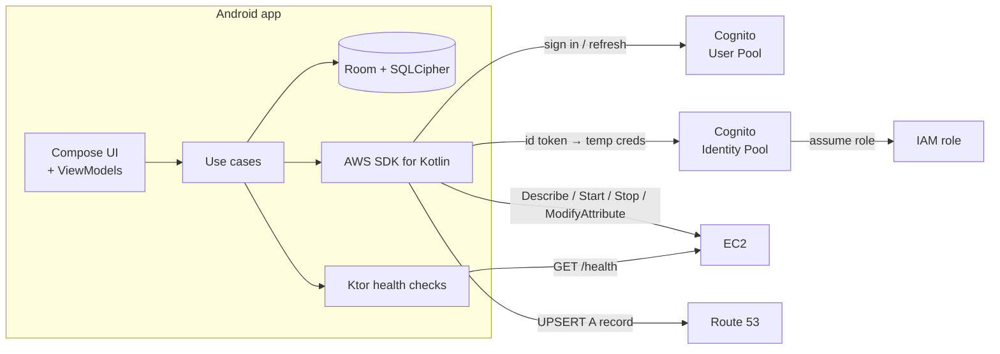

  

<h1 align="center">ServerWatcher</h1>

  Start, stop and monitor your AWS EC2 servers from your phone — and keep Route 53 DNS in sync automatically.

  
  
  
  
  
  
  

---

## What it does

ServerWatcher is a personal control panel for a handful of EC2 instances. You group instances under
**domains** and **subdomains**, flip one switch to bring a whole environment up or down, and the app
points your DNS at whichever instance is the primary once it is running.

- **One-tap environments** — a master switch per domain starts or stops every instance under it.
- **Live status** — EC2 state (pending / running / stopping / stopped) polled in the background, plus an
  optional HTTP health check per subdomain with a configurable expected status range.
- **Automatic DNS** — when a *primary* instance reaches `running`, its public IP is upserted as an
  `A` record in the linked Route 53 hosted zone.
- **Per-instance environment variables** — keep a set of `KEY=value` pairs per instance (import from
  JSON) and push them to the machine as cloud-init user data, written to `/etc/serverwatcher.env` on
  every boot.
- **Secure sign-in** — Cognito user pool with first-login password change and optional TOTP MFA
  (enrol an authenticator right from Settings); short-lived AWS credentials come from a
  Cognito identity pool, so no long-lived access keys ever live on the device.
- **Encrypted at rest** — tokens and config in `EncryptedSharedPreferences`, app data in a
  SQLCipher-encrypted Room database.

## How it fits together

The `cdk/` folder contains the CDK stack that provisions the user pool, identity pool and IAM role.

### Project layout

| Layer | Location |
|---|---|
| Domain models, repository interfaces, use cases | `app/.../core/domain/` |
| Room + SQLCipher, DAOs, mappers | `app/.../core/data/db/` |
| Cognito token manager, AWS clients, EC2 / Route 53 repositories | `app/.../core/data/aws/` |
| Health checks (Ktor) | `app/.../core/data/health/` |
| Hilt modules | `app/.../core/data/di/` |
| Feature screens + ViewModels | `app/.../feature/` (auth, home, domaindetail, instancedetail, settings, onboarding, splash) |
| Navigation | `app/.../navigation/NavGraph.kt` |
| Theme and design system | `app/.../ui/theme/`, `app/.../ui/design/` |
| Infrastructure as code | `cdk/` |

## Tech stack

Kotlin 2.0 · Jetpack Compose (Material 3) · Hilt · Room + SQLCipher · Kotlin Coroutines / Flow ·
AWS SDK for Kotlin (Cognito, EC2, Route 53) · Ktor client · Navigation Compose · AWS CDK (TypeScript)

## Install

### Download

**[⬇ Download ServerWatcher-latest.apk](apk/ServerWatcher-latest.apk?raw=true)** (version 0.1.0, about 38 MB,
Android 8.0 or newer) · [SHA-256 checksum](apk/ServerWatcher-latest.apk.sha256)

> [!WARNING]
> **Read this before you install.**
>
> - **Not from an app store.** This APK is not on Google Play and has not been reviewed by Google. You install
>   it by sideloading, so only install it if you trust this repository.
> - **Early release (0.x).** It is a single-developer project and may have bugs. It can start and stop your EC2
>   instances and change Route 53 DNS records, which can interrupt services and cost money. Try it on
>   non-critical servers first.
> - **You need your own AWS backend.** ServerWatcher has no server of its own. The app does nothing useful until
>   you deploy the CDK stack into **your** AWS account and enter its four values (see
>   [Getting started](#getting-started)). You pay AWS for whatever you run.
> - **Noncommercial use only,** under the [PolyForm Noncommercial license](LICENSE), and provided as is,
>   without warranty.
> - **Release signing key.** The app is signed with a project-owned key, not Google's. If a future version fails
>   to install over this one with a signature error, uninstall and reinstall. Your AWS setup lives in your
>   account, so you only re-enter the four values.

### Install on your phone

1. Open this page on your phone and tap the download link above, or copy the file over from a computer.
2. *(Recommended)* Check the download is genuine. On a computer, run `sha256sum -c ServerWatcher-latest.apk.sha256`
   (macOS: `shasum -a 256 -c`; Windows: `certutil -hashfile ServerWatcher-latest.apk SHA256` and compare).
   The value must match the one in the [`.sha256` file](apk/ServerWatcher-latest.apk.sha256).
3. Open the APK. Android asks you to **allow installs from this source** (your browser or file manager). Allow
   it for this one install, then go back and tap **Install**. You can switch the permission off afterwards.
4. If Play Protect says the app is unrecognised, that is expected for apps outside the Play Store. Choose
   **More details → Install anyway** if you trust this repository.
5. Open **ServerWatcher** and follow [Getting started](#getting-started) to connect your AWS account.

Signing certificate SHA-256, for the paranoid (`apksigner verify --print-certs`):
`4ebd6a2ffe6ad71280b1d10100ec982560d4a14a7456c1f326f501730f67b7ba`

### Uninstalling

Remove it like any app. Its data is stored only on your phone, in an encrypted database, and is deleted with
the app. Nothing is left in your AWS account except the stack you deployed; remove that with `npx cdk destroy`.

## Getting started

ServerWatcher has **no server of its own**. Each person deploys the small AWS backend into their own account,
so your credentials, instances and DNS never leave your phone and your AWS account.

1. **Deploy the backend** — `cd cdk && npm install && npx cdk deploy`
2. **Tag the EC2 instances** you want to manage with `ManagedBy=ServerWatcher`
3. **Create a Cognito user** for yourself
4. **Install the app** — use the [downloaded APK](#download), or build it yourself with `./gradlew assembleDebug`
5. **Open the app** and enter the four stack outputs on the onboarding screen

Full walkthrough, including CLI commands: [SETUP.md](SETUP.md).

Requirements: the AWS CLI configured for the account you deploy into and Node.js 18+. To build the app
yourself you also need Android Studio with SDK 35 and JDK 17.

## Screenshots

_Screenshots coming soon._

## Status

Early, single-user project under active development.

## Branches and releases

`dev` is where work happens; `release` is the default branch and carries the latest APK. Releases are cut by
tagging `release` — see [docs/RELEASING.md](docs/RELEASING.md).

## License

[PolyForm Noncommercial 1.0.0](LICENSE). You are free to use, study, modify and share ServerWatcher for any
noncommercial purpose (personal use, hobby projects, research, education, charities). You may **not** use it
for commercial purposes, which includes selling it or building it into a product or service you sell. If you
want to use it commercially, please get in touch. This is a source-available license rather than an OSI
open-source one, and this is not legal advice.

## Security notes

- The Cognito app client has no secret (it is a public mobile client); access is controlled by the
  user pool and the IAM role attached to the identity pool.
- Environment variables are pushed to EC2 **user data**, which is readable by anyone who can call
  `ec2:DescribeInstanceAttribute` on the instance. Do not use it for high-value secrets.
